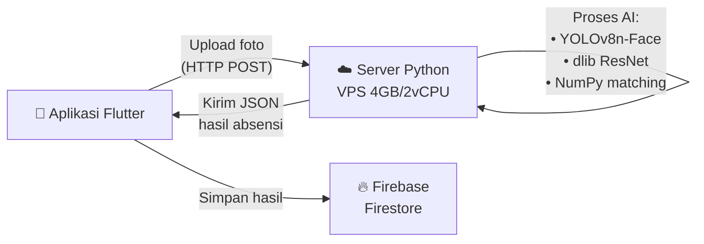
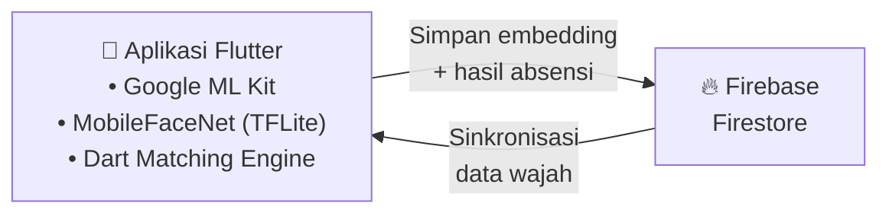
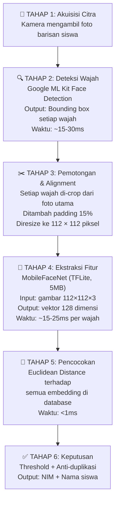
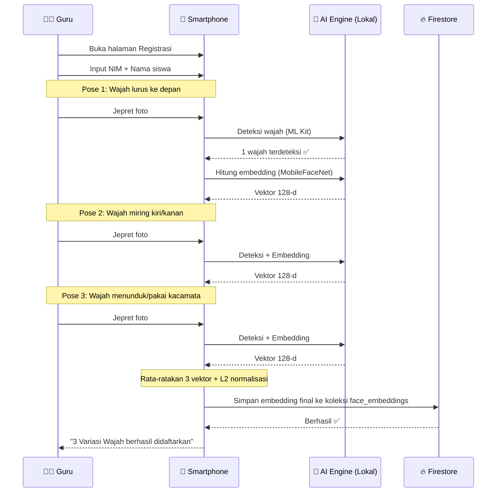
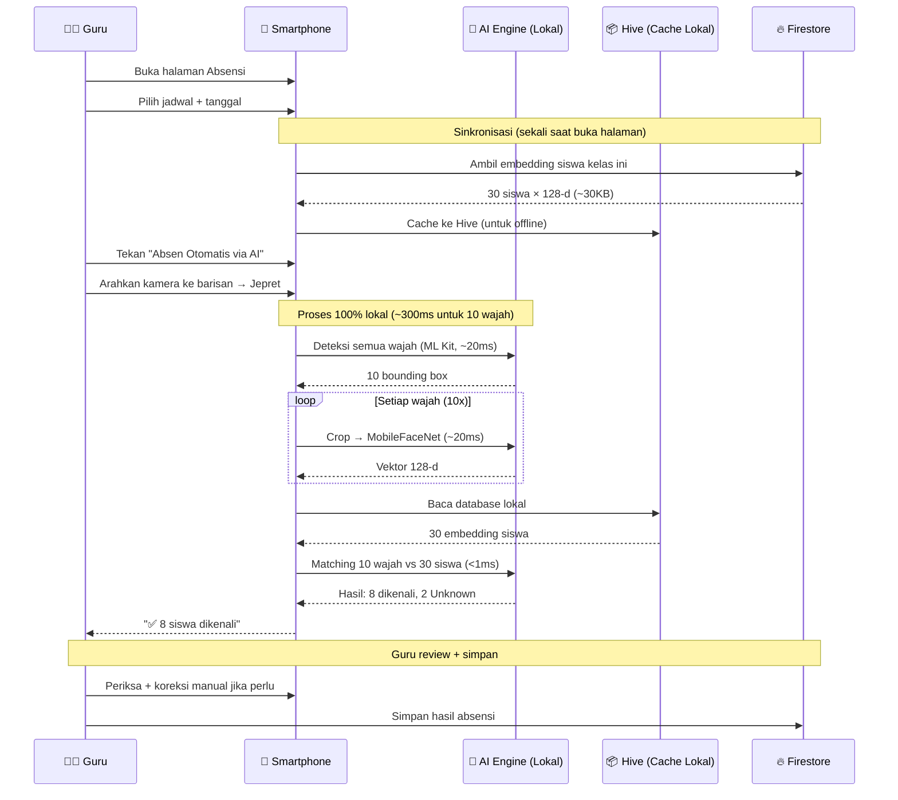

# Sistem Absensi Wajah Berbasis On-Device AI
## SIAP — Sistem Informasi Akademik Pintar

---

## 1. Latar Belakang Masalah

Pada arsitektur sebelumnya, seluruh proses pengenalan wajah dilakukan di **server cloud** (VPS 4GB RAM / 2 vCPU). Alurnya:

```
Smartphone → upload foto (HTTP) → Server Python → proses AI → kirim hasil (JSON) → Smartphone
```

Arsitektur ini memiliki beberapa kelemahan:

| Masalah | Dampak |
|---------|--------|
| Bergantung pada koneksi internet | Jika jaringan lambat/putus, absensi gagal total |
| Latensi tinggi (1–60 detik) | Guru dan siswa harus menunggu lama |
| Beban server terpusat | 1 server melayani semua request, rentan overload |
| Biaya operasional | Server harus tetap menyala 24/7, butuh spesifikasi tinggi untuk AI |

**Solusi dari dosen pembimbing:** Pindahkan proses deteksi dan ekstraksi fitur wajah ke dalam smartphone, menggunakan **TensorFlow Lite** yang diintegrasikan ke aplikasi **Flutter**.

---

## 2. Arsitektur Sistem

### 2.1. Arsitektur Lama (Server-Based)



**Komponen server:**
- **YOLOv8n-Face** — model object detection untuk mendeteksi lokasi wajah dalam foto
- **dlib ResNet** — model deep learning untuk mengekstraksi vektor fitur wajah 128 dimensi
- **NumPy** — library komputasi untuk menghitung jarak antar vektor (face matching)
- **FastAPI** — framework web untuk menerima HTTP request dari aplikasi

### 2.2. Arsitektur Baru (On-Device)



**Seluruh proses AI berjalan di dalam smartphone:**
- **Google ML Kit Face Detection** — mendeteksi lokasi wajah (menggantikan YOLOv8)
- **MobileFaceNet via TensorFlow Lite** — mengekstraksi vektor fitur wajah 128 dimensi (menggantikan dlib ResNet)
- **Euclidean Distance di Dart** — mencocokkan wajah terhadap database (menggantikan NumPy)
- **Firebase Firestore** — penyimpanan vektor embedding yang tersinkronisasi antar perangkat
- **Hive** — database lokal di smartphone untuk cache offline

---

## 3. Pipeline Pengenalan Wajah On-Device

Seluruh pipeline berjalan secara sekuensial di dalam smartphone dengan total waktu **50–500ms** (tergantung jumlah wajah):



### 3.1. Tahap 1 — Akuisisi Citra

Aplikasi menggunakan paket `camera` Flutter untuk mengakses kamera perangkat. Foto diambil dalam resolusi tinggi (`ResolutionPreset.high`) untuk memastikan wajah yang jauh (dalam barisan kelas) masih memiliki detail yang cukup.

### 3.2. Tahap 2 — Deteksi Wajah (Google ML Kit)

Google ML Kit Face Detection digunakan untuk mendeteksi **lokasi** semua wajah dalam satu foto. Output-nya berupa daftar `bounding box` (koordinat x1, y1, x2, y2) untuk setiap wajah yang terdeteksi.

**Mengapa Google ML Kit, bukan YOLOv8?**

| Aspek | YOLOv8 di Server | Google ML Kit di HP |
|-------|-------------------|---------------------|
| Manajemen model | Harus download & kelola file `.pt` sendiri | Sudah tertanam di Android (Google Play Services) |
| Ukuran tambahan di APK | +6MB (file model) | 0 MB (sudah bawaan sistem) |
| Optimasi | Umum (CPU server) | Dioptimasi khusus untuk chip mobile (GPU/NPU/DSP) |
| Fitur | Bounding box saja | Bounding box + landmark wajah (mata, hidung, mulut) |
| Kecepatan | ~200ms (server) | ~15-30ms (HP) |

**Konfigurasi yang digunakan:**
```dart
FaceDetectorOptions(
  enableLandmarks: true,           // Deteksi posisi mata, hidung, mulut
  performanceMode: FaceDetectorMode.accurate,  // Prioritas akurasi
  minFaceSize: 0.1,                // Bisa deteksi wajah kecil (10% dari frame)
)
```

### 3.3. Tahap 3 — Pemotongan dan Alignment

Setiap wajah yang terdeteksi dipotong dari foto utama dengan menambahkan **padding 15%** di sekeliling bounding box. Padding ini memastikan seluruh kontur wajah (termasuk dahi dan dagu) tertangkap, bukan hanya area tengah wajah.

```
Foto asli 4000×3000        Crop + padding 15%        Resize
┌─────────────────┐        ┌───────────┐              ┌────┐
│    ┌─────┐      │   →    │  ┌─────┐  │    →         │    │ 112×112 px
│    │wajah│      │        │  │wajah│  │              │    │
│    └─────┘      │        │  └─────┘  │              └────┘
└─────────────────┘        └───────────┘
```

Hasil crop kemudian di-resize ke **112 × 112 piksel** sesuai dengan ukuran input yang dibutuhkan oleh model MobileFaceNet.

### 3.4. Tahap 4 — Ekstraksi Fitur (MobileFaceNet)

MobileFaceNet adalah Convolutional Neural Network (CNN) berbasis arsitektur **MobileNetV2** yang dilatih khusus untuk pengenalan wajah menggunakan loss function **ArcFace**. Model ini mengubah gambar wajah menjadi **vektor numerik 128 dimensi** yang disebut **face embedding**.

**Spesifikasi model:**
| Parameter | Nilai |
|-----------|-------|
| Arsitektur | Modified MobileNetV2 |
| Ukuran model | ~5 MB (.tflite) |
| Input | Tensor [1, 112, 112, 3] (RGB, float32) |
| Output | Tensor [1, 128] (face embedding) |
| Akurasi | 99.4% pada benchmark LFW |
| Inference time | 15-25ms pada HP mid-range |

**Pra-pemrosesan gambar:**

Nilai piksel dinormalisasi ke rentang [-1, 1] karena model dilatih menggunakan normalisasi ini:

$$x_{norm} = \frac{x_{pixel} - 127.5}{127.5}$$

**Pasca-pemrosesan embedding:**

Vektor output di-normalisasi dengan **L2 normalization** agar panjangnya = 1:

$$\vec{e}_{norm} = \frac{\vec{e}}{||\vec{e}||_2}$$

Tujuannya agar Euclidean distance dan Cosine similarity menghasilkan ranking yang setara, sehingga perbandingan antar wajah konsisten.

**Mengapa MobileFaceNet, bukan dlib ResNet?**

| Aspek | dlib ResNet di Server | MobileFaceNet di HP |
|-------|----------------------|---------------------|
| Ukuran model | ~29 MB | ~5 MB |
| Dirancang untuk | PC/Server (x86) | Mobile (ARM) |
| Bisa dikonversi ke TFLite? | Tidak (format proprietary dlib) | Sudah tersedia sebagai .tflite |
| Dimensi output | 128-d | 128-d (sama) |
| Kecepatan di mobile | Tidak bisa jalan | 15-25ms |

### 3.5. Tahap 5 — Pencocokan (Face Matching)

Untuk menentukan identitas seseorang, embedding wajah yang baru diambil dibandingkan dengan seluruh embedding siswa yang tersimpan di database menggunakan **Euclidean Distance**:

$$d(\vec{a}, \vec{b}) = \sqrt{\sum_{i=1}^{128}(a_i - b_i)^2}$$

- Jarak **kecil** = wajah mirip (kemungkinan orang yang sama)
- Jarak **besar** = wajah berbeda (orang yang berbeda)

### 3.6. Tahap 6 — Keputusan dengan Threshold dan Anti-Duplikasi

Sistem menerapkan 3 aturan keputusan:

**Aturan 1 — Batas Terima (Threshold):**

Jika jarak terbaik melebihi nilai `batasTerima`, wajah ditandai sebagai **Unknown** (tidak dikenali). Nilai threshold ini dikalibrasi melalui pengujian lapangan.

**Aturan 2 — Selisih Minimal (Anti-Ambiguitas):**

Jika selisih antara kandidat terbaik dan kandidat kedua kurang dari `selisihMinimal` (0.06), maka sistem **menolak** kecocokan karena tidak cukup yakin. Ini mencegah kesalahan identifikasi saat dua orang memiliki wajah yang mirip.

**Aturan 3 — Penugasan Unik (Anti-Duplikasi):**

Satu NIM hanya boleh dipasangkan dengan satu wajah dalam satu foto. Jika "Budi Santoso" sudah cocok dengan wajah #1, maka wajah #3 yang juga mirip Budi **tidak akan** mendapat label Budi lagi. Ini mencegah satu siswa tercatat hadir dua kali.

```
Semua kandidat diurutkan berdasarkan jarak (terbaik dulu):
  Wajah #2 → Andi  (jarak 0.65) ✅ Terima
  Wajah #1 → Budi  (jarak 0.72) ✅ Terima
  Wajah #3 → Budi  (jarak 0.85) ❌ Tolak (Budi sudah dipakai wajah #1)
  Wajah #4 → ???   (jarak 1.30) ❌ Tolak (melebihi batasTerima)
```

---

## 4. Alur Penggunaan Sistem

### 4.1. Alur Registrasi Wajah Siswa



**Mengapa 3 pose?**

Dengan merata-ratakan embedding dari 3 sudut/kondisi berbeda, vektor representasi menjadi lebih **robust** terhadap variasi pose saat absensi nanti. Ini meningkatkan tingkat pengenalan di kondisi lapangan yang tidak ideal.

$$\vec{e}_{final} = \text{normalize}\left(\frac{\vec{e}_1 + \vec{e}_2 + \vec{e}_3}{3}\right)$$

### 4.2. Alur Absensi Kelas (Scan Multi-Wajah)



---

## 5. Penyimpanan Data

### 5.1. Struktur Firestore

```
🔥 Firestore Database
│
├── face_embeddings/                    ← KOLEKSI BARU (vektor wajah)
│   ├── {NIM}/
│   │   ├── nim: "2201001"
│   │   ├── name: "Budi Santoso"
│   │   ├── embedding: [0.023, -0.156, ..., 0.089]   ← 128 angka float
│   │   └── updatedAt: Timestamp
│   └── ...
│
├── attendance/                         ← KOLEKSI EXISTING (hasil absensi)
│   ├── {scheduleId}_{tanggal}/
│   │   ├── classId, className, subjectName, date
│   │   └── records: [{studentId, studentName, status}, ...]
│   └── ...
│
├── classes/                            ← KOLEKSI EXISTING
│   ├── {classId}/
│   │   └── students/ (sub-collection)
│   │       ├── {studentDocId}/
│   │       │   ├── name, email, nisNip, photoBase64
│   │       │   └── ...
│   │       └── ...
│   └── ...
```

### 5.2. Efisiensi Penyimpanan

| Data | Ukuran per siswa | 180 siswa |
|------|-----------------|-----------|
| Embedding (128 × float64) | ~1 KB | ~180 KB |
| Foto thumbnail (base64, 150px) | ~3 KB | ~540 KB |
| **Total** | **~4 KB** | **~720 KB** |

Data ini sangat kecil sehingga:
- Sinkronisasi dari Firestore ke HP memakan waktu **< 1 detik** bahkan di jaringan lambat
- Seluruh database bisa disimpan di RAM HP tanpa masalah
- Pencarian brute-force (membandingkan 1 wajah vs 180 embedding) selesai dalam **< 1ms**

---

## 6. Teknologi yang Digunakan

### 6.1. Teknologi Utama

| Komponen | Teknologi | Versi | Fungsi |
|----------|-----------|-------|--------|
| Framework Aplikasi | Flutter | 3.x | UI cross-platform |
| State Management | Riverpod | 2.5+ | Manajemen state reaktif |
| Deteksi Wajah | Google ML Kit Face Detection | 0.12.0 | Lokalisasi wajah dalam foto |
| Ekstraksi Fitur | MobileFaceNet (TensorFlow Lite) | 0.11.0 | Embedding 128-d |
| Database Cloud | Firebase Firestore | 5.2+ | Penyimpanan embedding + absensi |
| Database Lokal | Hive | 2.2.3 | Cache offline |
| Kamera | Camera Plugin | 0.10.5 | Akses kamera perangkat |

### 6.2. Komponen AI

| Model | Arsitektur | Input | Output | Ukuran | Akurasi |
|-------|------------|-------|--------|--------|---------|
| Face Detection | Google ML Kit (built-in) | Foto resolusi apapun | Bounding box + landmark | 0 MB (bawaan OS) | >98% |
| Face Embedding | MobileFaceNet (MobileNetV2 + ArcFace) | 112×112×3 RGB | Vektor 128-d | 5 MB | 99.4% (LFW) |

---

## 7. Perbandingan Performa

| Metrik | Server (Lama) | On-Device (Baru) | Peningkatan |
|--------|--------------|-------------------|-------------|
| Deteksi 1 wajah | ~200ms + network | ~20ms | **10x lebih cepat** |
| Embedding 1 wajah | ~150ms + network | ~20ms | **7x lebih cepat** |
| Network round-trip | 500–3000ms | 0ms | **Dihilangkan** |
| Total 1 wajah | 1–5 detik | ~50ms | **20-100x lebih cepat** |
| Total 10 wajah | 5–60 detik | ~300ms | **16-200x lebih cepat** |
| Bisa offline | ❌ Tidak | ✅ Ya | — |
| Butuh server AI | ✅ VPS 24/7 | ❌ Tidak | Hemat biaya |

---

## 8. Keunggulan Arsitektur On-Device

### 8.1. Real-Time
Proses pengenalan wajah selesai dalam **50–500ms** (tergantung jumlah wajah), memberikan pengalaman yang terasa instan bagi pengguna.

### 8.2. Offline-Capable
Setelah data embedding disinkronisasi, absensi dapat dilakukan **tanpa koneksi internet**. Ini kritis untuk sekolah di daerah dengan jaringan tidak stabil.

### 8.3. Privasi Data
Foto wajah siswa **tidak pernah meninggalkan perangkat**. Yang disimpan di cloud hanya vektor angka 128 dimensi yang tidak bisa direkonstruksi menjadi foto wajah.

### 8.4. Skalabilitas
Setiap smartphone memproses AI-nya sendiri — tidak ada bottleneck server. Jika 10 guru mengambil absensi bersamaan, masing-masing HP bekerja independen.

### 8.5. Biaya Operasional Rendah
Tidak memerlukan server GPU atau VPS berspesifikasi tinggi yang harus dinyalakan 24/7 untuk menjalankan model AI.

---

## 9. Struktur Kode Aplikasi

```
lib/
├── main.dart                              ← Entry point, inisialisasi Firebase + Hive
│
├── core/
│   ├── ai/                                ← 🧠 MODUL AI (5 file)
│   │   ├── face_detector_service.dart     ← Wrapper Google ML Kit
│   │   ├── face_embedding_service.dart    ← Wrapper TFLite MobileFaceNet
│   │   ├── face_matching_service.dart     ← Logika pencocokan + threshold
│   │   ├── face_database_service.dart     ← Sinkronisasi Firestore ↔ Hive
│   │   └── ai_providers.dart              ← Riverpod dependency injection
│   ├── constants/
│   ├── routing/
│   ├── theme/
│   └── utils/
│
├── features/
│   ├── attendance/                        ← Fitur Absensi
│   │   ├── presentation/
│   │   │   ├── AttendanceScreen.dart       ← UI scan wajah (on-device)
│   │   │   └── attendance_view.dart        ← UI pilih jadwal + tanggal
│   │   ├── models/
│   │   ├── datasources/
│   │   └── widgets/
│   │
│   ├── academic_management/               ← Fitur Akademik
│   │   └── presentation/
│   │       └── RegisterStudentScreen.dart  ← UI registrasi wajah (on-device)
│   │
│   ├── auth/                              ← Fitur Login
│   └── home/
│
└── assets/
    └── models/
        └── mobilefacenet.tflite           ← Model AI (5MB)
```
