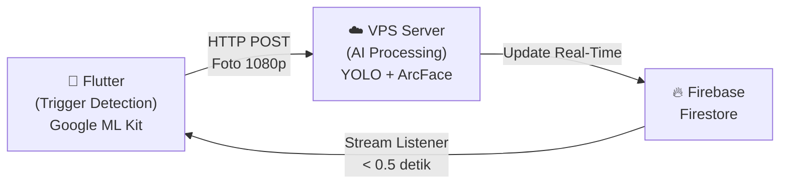
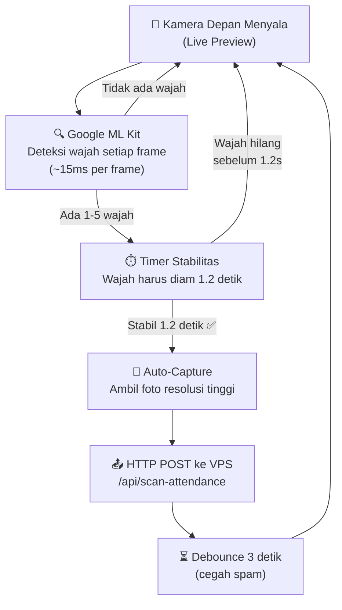
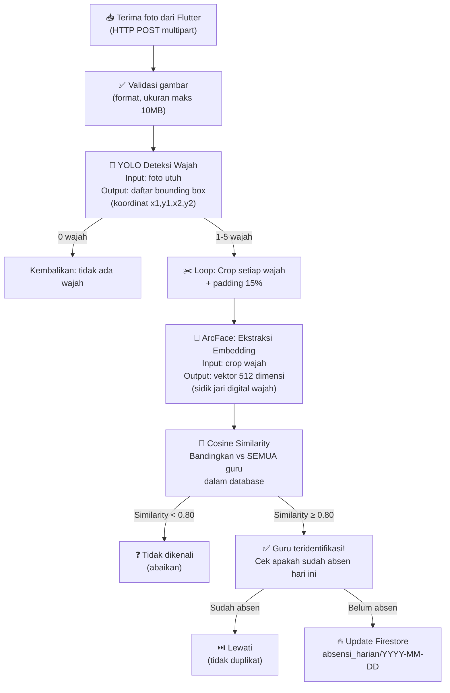
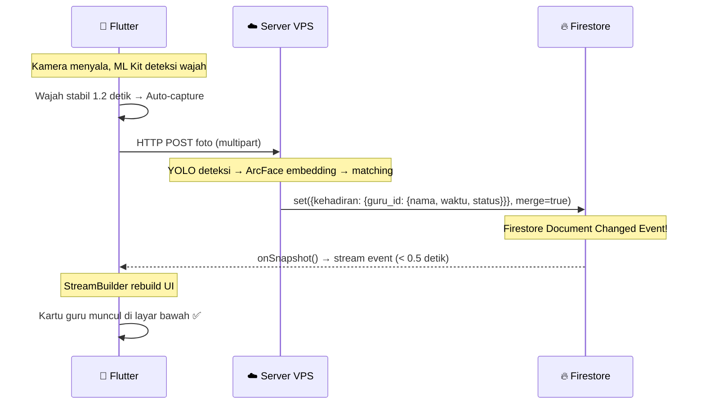
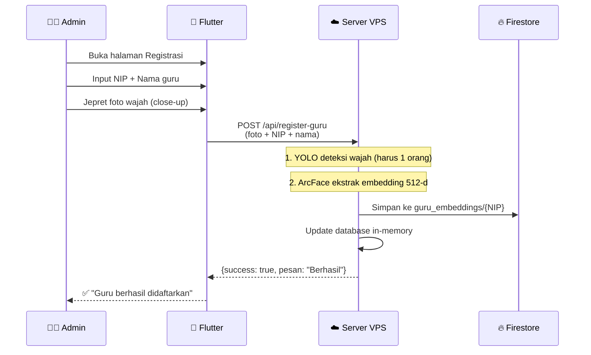
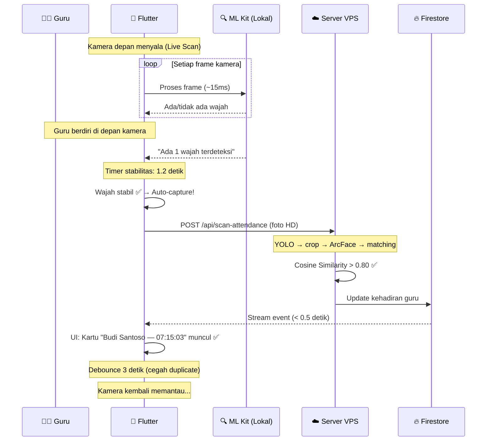

# Penjelasan Sistem Absensi Wajah Guru
## Arsitektur Hybrid & Event-Driven

---

## 1. Gambaran Umum Sistem

Sistem ini adalah **Sistem Absensi Wajah Real-Time untuk Guru** yang menggunakan arsitektur **Hybrid & Event-Driven**, dimana pemrosesan AI dilakukan di **sisi server (VPS)** sementara deteksi trigger dilakukan di **sisi client (smartphone)**.



**Prinsip Hybrid:**
- **Client (HP)** bertugas sebagai **sensor** — memantau keberadaan wajah dan mengirim foto saat wajah terdeteksi stabil
- **Server (VPS)** bertugas sebagai **otak** — melakukan pengenalan wajah (siapa orangnya) dan mencatat kehadiran
- **Firebase Firestore** bertugas sebagai **penghubung real-time** — server menulis, Flutter membaca perubahan secara instan

**Prinsip Event-Driven:**
- Sistem tidak melakukan polling berkala. Setiap aksi dipicu oleh **event**:
  - Wajah terdeteksi stabil → trigger capture (event di client)
  - Foto diterima server → trigger YOLO + ArcFace (event di server)  
  - Firestore berubah → trigger UI update (event di Flutter via StreamBuilder)

---

## 2. Komponen Teknologi

| Komponen | Teknologi | Peran |
|----------|-----------|-------|
| Framework Aplikasi | **Flutter** (Dart) | UI mobile cross-platform (Android/iOS) |
| Trigger Detection | **Google ML Kit Face Detection** | Mendeteksi keberadaan wajah di kamera HP secara real-time |
| Deteksi Wajah (Core TA) | **YOLOv8n-Face** (Ultralytics) | Melokalisasi koordinat semua wajah dalam foto di server |
| Pengenalan Wajah | **ArcFace** via DeepFace | Mengekstrak embedding 512-d dan menghitung kemiripan |
| Metric Kemiripan | **Cosine Similarity** | Mengukur kecocokan antara dua vektor embedding |
| Database Cloud | **Firebase Firestore** | Penyimpanan kehadiran + sinkronisasi real-time |
| Web Framework | **FastAPI** (Python) | API endpoint di server VPS |
| Server | **VPS 4GB RAM / 2 vCPU** | Menjalankan model AI |

---

## 3. Pipeline Pengenalan Wajah (Detail)

### 3.1. Tahap Client — Trigger Detection (di Smartphone)



**Mengapa ML Kit di client, bukan langsung kirim semua frame?**

| Tanpa ML Kit | Dengan ML Kit |
|---|---|
| Kirim foto setiap 1 detik ke server | Kirim foto HANYA saat ada wajah |
| Server dibanjiri foto kosong | Server hanya menerima foto berguna |
| Boros bandwidth & baterai | Hemat bandwidth & baterai |
| Server overload | Server beban minimal |

ML Kit hanya menjawab pertanyaan **"Ada wajah tidak?"** (ya/tidak). ML Kit **TIDAK** menjawab **"Siapa orangnya?"** — itu tugas YOLO + ArcFace di server.

### 3.2. Tahap Server — AI Processing (di VPS)



### 3.3. Tahap Sinkronisasi — Real-Time Update (Firebase)



---

## 4. Deteksi Wajah dengan YOLO (Core Tugas Akhir)

### 4.1. Apa itu YOLO?

**YOLO (You Only Look Once)** adalah arsitektur deep learning untuk **object detection** yang memprediksi bounding box dan kelas objek dalam **satu kali forward pass** (satu kali lihat), berbeda dengan metode tradisional yang memerlukan sliding window atau region proposals.

### 4.2. Mengapa YOLO untuk Deteksi Wajah?

| Aspek | Metode Tradisional (Haar Cascade) | YOLO |
|-------|-----------------------------------|------|
| Akurasi | Rendah (banyak false positive) | Tinggi (deep learning) |
| Multi-wajah | Lambat (sliding window) | Cepat (single pass) |
| Variasi pose | Buruk | Baik |
| Cahaya rendah | Buruk | Baik |
| Real-time | Sulit | Sudah didesain untuk real-time |

### 4.3. Varian yang Digunakan: YOLOv26n (Nano - Ultralytics Release 2026)

- **Arsitektur NMS-Free End-to-End:** Mengeliminasi proses *Non-Maximum Suppression* tradisional, menghasilkan latensi inferensi yang jauh lebih rendah dan konsisten di CPU VPS.
- **DFL-Free (Distribution Focal Loss Removal):** Menyederhanakan proses regresi koordinat bounding box dan mempercepat ekspor serta inferensi di VPS 4GB RAM.
- **Nano (n):** Varian teringan dan tercepat dari keluarga YOLOv26, dirancang khusus untuk inferensi real-time berkecepatan tinggi.
- **Input:** Gambar resolusi 640×640 piksel.
- **Output:** Koordinat multi-bounding box `[x1, y1, x2, y2]` dengan confidence score.
- **Kecepatan Inferensi:** ~25-45 ms per frame di CPU VPS.

### 4.4. Multi-Face Detection

Dalam skenario absensi guru, 1 foto bisa menangkap **1 sampai 5 wajah sekaligus** (guru berdiri berdekatan). YOLO mendeteksi SEMUA wajah dalam satu inferensi:

```
Input: 1 foto barisan 3 guru
Output YOLO:
  Wajah #1: [120, 80, 280, 320]   conf: 0.95
  Wajah #2: [350, 90, 510, 330]   conf: 0.91
  Wajah #3: [580, 85, 740, 325]   conf: 0.88
```

Setiap bounding box kemudian di-crop dengan padding 15% dan dikirim ke ArcFace untuk identifikasi.

---

## 5. Pengenalan Wajah dengan ArcFace

### 5.1. Apa itu Face Embedding?

Face embedding adalah representasi matematis dari wajah seseorang berupa **vektor angka berdimensi tinggi** (512 angka desimal). Vektor ini menangkap fitur-fitur unik wajah (jarak antar mata, bentuk hidung, kontur rahang, dll) yang tidak bisa dilihat langsung oleh mata manusia.

```
Foto wajah Budi → ArcFace → [0.023, -0.156, 0.089, ..., 0.045]
                              ↑ 512 angka ini = "sidik jari digital" Budi
```

### 5.2. ArcFace (Additive Angular Margin Loss)

ArcFace adalah state-of-the-art loss function untuk face recognition yang menambahkan **angular margin** pada ruang embedding. Ini membuat embedding wajah orang yang berbeda terpisah lebih jauh, sementara embedding wajah orang yang sama tetap berdekatan.

**Akurasi:** 99.83% pada benchmark LFW (Labeled Faces in the Wild)

### 5.3. Cosine Similarity

Untuk membandingkan dua embedding, digunakan **Cosine Similarity**:

$$\text{cos}(\theta) = \frac{\vec{A} \cdot \vec{B}}{||\vec{A}|| \times ||\vec{B}||} = \frac{\sum_{i=1}^{512} A_i \times B_i}{\sqrt{\sum_{i=1}^{512} A_i^2} \times \sqrt{\sum_{i=1}^{512} B_i^2}}$$

| Nilai | Artinya |
|-------|---------|
| 1.0 | Identik (orang yang sama, foto yang sama) |
| 0.85 - 0.99 | Sangat mirip (orang yang sama, foto berbeda) |
| **≥ 0.80** | **Threshold: diterima sebagai COCOK** |
| 0.50 - 0.79 | Agak mirip (orang berbeda tapi ada kemiripan) |
| < 0.50 | Sangat berbeda (orang berbeda) |

**Mengapa Cosine Similarity, bukan Euclidean Distance?**

- Cosine similarity **invariant terhadap magnitudo** vektor — hanya mengukur arah (sudut) antar vektor
- Rentang nilainya tetap [0, 1] sehingga threshold lebih intuitif
- ArcFace dilatih mengoptimalkan angular margin, sehingga cosine similarity lebih sesuai

---

## 6. Struktur Data Firestore

### 6.1. Koleksi `guru_embeddings` (Data Wajah Guru)

```
🔥 Firestore
└── guru_embeddings/                  ← Koleksi embedding wajah
    ├── {guru_id}/                    ← Document ID = NIP atau ID unik
    │   ├── nama: "Budi Santoso, S.Pd."
    │   ├── nip: "199201152020011001"
    │   ├── embedding: [0.023, -0.156, ..., 0.045]   ← 512 angka float
    │   └── updatedAt: Timestamp
    └── ...
```

### 6.2. Koleksi `absensi_harian` (Rekap Kehadiran)

```
🔥 Firestore
└── absensi_harian/                   ← Koleksi kehadiran harian
    ├── 2026-10-01/                   ← Document ID = tanggal
    │   ├── tanggal: "2026-10-01"
    │   └── kehadiran:                ← Map guru yang sudah absen
    │       ├── guru_001:
    │       │   ├── nama: "Budi Santoso, S.Pd."
    │       │   ├── nip: "199201152020011001"
    │       │   ├── waktu: "07:15:03"
    │       │   ├── similarity: 0.8723
    │       │   └── status: "hadir"
    │       ├── guru_002:
    │       │   ├── nama: "Sari Dewi, M.Pd."
    │       │   ├── waktu: "07:15:08"
    │       │   ├── similarity: 0.9104
    │       │   └── status: "hadir"
    │       └── ...
    └── ...
```

### 6.3. Mengapa Menggunakan Firestore?

| Fitur | Keunggulan |
|-------|-----------|
| **Real-time listener** | Flutter menerima update dalam < 0.5 detik tanpa polling |
| **Offline support** | Data di-cache lokal, bisa dibaca tanpa internet |
| **Merge write** | `set({...}, merge=true)` → tidak menimpa data guru lain |
| **Scalable** | Skalabel untuk ratusan guru tanpa konfigurasi tambahan |
| **Security Rules** | Bisa dibatasi siapa yang boleh membaca/menulis |

---

## 7. Alur Lengkap End-to-End

### 7.1. Alur Registrasi Guru



### 7.2. Alur Absensi Harian (Scan Guru)



---

## 8. Perbandingan Performa

| Metrik | Tanpa Event-Driven | Dengan Event-Driven (Sistem Ini) |
|--------|-------------------|-----------------------------------|
| Pengiriman foto | Setiap N detik (boros) | Hanya saat ada wajah stabil (efisien) |
| Beban server | Tinggi (banyak foto kosong) | Rendah (hanya foto berisi wajah) |
| Update UI | Polling tiap detik | Real-time via Firestore stream |
| Latensi UI update | 1-5 detik | < 0.5 detik |
| Penggunaan bandwidth | Tinggi | Rendah |
| Penggunaan baterai HP | Tinggi | Sedang (ML Kit dioptimasi) |

---

## 9. Mekanisme Anti-Duplikasi & Anti-Error

| Mekanisme | Penjelasan |
|-----------|-----------|
| **Debounce 3 detik** | Setelah capture, HP tidak capture lagi selama 3 detik |
| **Stabilitas 1.2 detik** | Wajah harus diam 1.2s sebelum auto-capture (cegah capture saat lewat) |
| **Threshold 0.80** | Hanya kecocokan ≥ 80% yang diterima (cegah salah identifikasi) |
| **Cek duplikat Firestore** | Jika guru sudah absen hari ini, tidak dicatat ulang |
| **Anti-duplikasi per frame** | Dalam 1 foto yang sama, 1 guru hanya boleh cocok 1 kali |
| **Semaphore(2)** | Maksimal 2 request AI bersamaan di server (cegah RAM habis) |
| **Validasi gambar** | Cek format dan ukuran file sebelum diproses |
| **Error handler global** | Server tidak crash meskipun ada error |

---

## 10. Desain UI Aplikasi

```
┌──────────────────────────────────────┐
│            ABSENSI WAJAH GURU        │  AppBar (indigo)
│                            12 hadir  │
├──────────────────────────────────────┤
│                                      │
│     ┌──────────────────────────┐     │
│     │                          │     │
│     │    LIVE CAMERA PREVIEW   │     │  60% layar
│     │         (Kamera Depan)   │     │
│     │                          │     │
│     │  ┌────────────────────┐  │     │
│     │  │ 🔍 1 wajah — stabil│  │     │  Status overlay
│     │  └────────────────────┘  │     │
│     │                    LIVE  │     │
│     └──────────────────────────┘     │
│                                      │
├──────────────────────────────────────┤
│  👥 Kehadiran Hari Ini — 2026-10-01 │  Header
├──────────────────────────────────────┤
│  ┌────────────────────────────────┐  │
│  │ ✅ Budi Santoso, S.Pd.        │  │
│  │    NIP: 19920115...   07:15:03│  │  Card #1
│  └────────────────────────────────┘  │
│  ┌────────────────────────────────┐  │
│  │ ✅ Sari Dewi, M.Pd.           │  │
│  │    NIP: 19850620...   07:15:08│  │  Card #2  40% layar
│  └────────────────────────────────┘  │
│  ┌────────────────────────────────┐  │
│  │ ✅ Andi Prasetyo, S.Kom.      │  │
│  │    NIP: 19900301...   07:16:22│  │  Card #3
│  └────────────────────────────────┘  │
└──────────────────────────────────────┘
```

**Area Atas (60%):** Preview kamera depan dengan overlay status dan badge "LIVE"  
**Area Bawah (40%):** Daftar guru yang sudah absen, di-update real-time via Firestore StreamBuilder

---

## 11. Struktur File Kode

### 11.1. Server Python (VPS)

```
server_guru/
├── main.py                    ← File utama (API + AI + Firebase)
├── requirements.txt           ← Dependencies Python
└── firebase-adminsdk.json     ← Kredensial Firebase (tidak di-commit)
```

### 11.2. Aplikasi Flutter (Mobile)

```
lib/features/guru_attendance/
└── presentation/
    ├── guru_scan_screen.dart      ← Halaman scan (kamera + auto-capture + Firestore)
    └── guru_register_screen.dart  ← Halaman registrasi wajah guru baru
```

### 11.3. Endpoint API Server

| Method | Endpoint | Fungsi |
|--------|----------|--------|
| `POST` | `/api/scan-attendance` | Terima foto → deteksi → kenali → catat ke Firestore |
| `POST` | `/api/register-guru` | Daftarkan wajah guru baru |
| `POST` | `/api/reload-database` | Muat ulang database guru tanpa restart |
| `GET` | `/` | Status server + daftar guru terdaftar |

### 11.4. Dependencies

**Python (pip):**
```
fastapi, uvicorn, python-multipart
ultralytics (YOLO)
deepface (ArcFace)
opencv-python-headless, numpy, Pillow
firebase-admin
```

**Flutter (pubspec.yaml):**
```
camera, google_mlkit_face_detection
cloud_firestore, http, intl, image_picker
```
