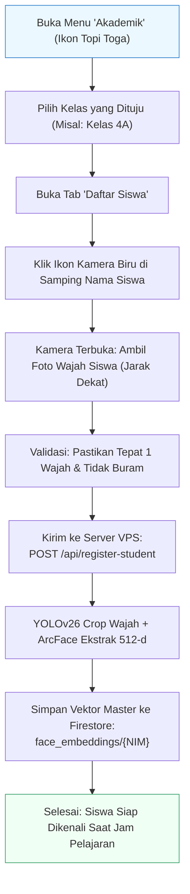

# PANDUAN OPERASIONAL & FLOWCHART SISTEM ABSENSI WAJAH
## Implementasi YOLOv26 dan ArcFace pada Sistem Presensi Akademik Real-Time

---

## BAB 1: ARSITEKTUR & FLOWCHART SISTEM

### 1.1. Flowchart Alur Operasional Guru di Kelas (Mode Presensi)

Flowchart berikut menggambarkan alur interaksi Guru saat melakukan presensi di kelas, baik menggunakan **Skenario Tripod (Mandiri)** maupun **Skenario Handheld (Pindai Barisan Meja)**.

```mermaid
flowchart TD
    Start(["Mulai: Guru Membuka Aplikasi SIAP"]) --> Login["Login dengan Akun Role Guru"]
    Login --> PortalGuru["Masuk ke Menu 'Portal Guru' -> Tab 'Input Absensi'"]
    PortalGuru --> PilihJadwal["Pilih Jadwal Mengajar & Tanggal Hari Ini\n(Contoh: Kelas 4A - Fisika)"]
    PilihJadwal --> BukaKamera["Tekan Tombol '📷 Absen Otomatis via AI'"]
    
    BukaKamera --> PilihMode{"Pilih Skenario\nOperasional di Kelas"}
    
    %% Skenario 1: Tripod
    PilihMode -- "Skenario A:\nTripod di Meja Guru" --> TripodSetup["Letakkan HP pada Tripod/Stand di Meja Guru\n(Kamera Depan Standby / Live Scan)"]
    TripodSetup --> SiswaDatang["Siswa Berdiri Tenang di Depan HP\n(1 s.d 5 Siswa Sekaligus)"]
    SiswaDatang --> MLKitDetect{"Google ML Kit (HP):\nWajah Stabil Selama 1.2 Detik?"}
    MLKitDetect -- "Tidak / Bergerak" --> SiswaDatang
    MLKitDetect -- "Ya (Wajah Diam)" --> AutoCap["Sistem Melakukan Auto-Capture Otomatis\n(Tanpa Sentuh Layar)"]
    AutoCap --> Debounce["Aktifkan Debounce 3 Detik\n(Kamera Jeda Cegah Multi-Foto)"]
    AutoCap --> KirimServer["Kirim Frame Foto ke Server VPS\nPOST /api/scan-attendance"]

    %% Skenario 2: Handheld
    PilihMode -- "Skenario B:\nHandheld (Dipegang Guru)" --> HandheldSetup["Guru Berdiri di Depan Kelas Memegang HP\n(Arahkan Kamera ke Barisan Bangku Siswa)"]
    HandheldSetup --> JepretBarisan["Jepret Foto Barisan Meja Siswa\n(YOLOv26 Menangkap 1-5 Wajah Sekaligus)"]
    JepretBarisan --> KirimServer

    %% Pemrosesan Server & Database
    KirimServer --> ServerProcess["Server VPS (YOLOv26 + ArcFace):\n1. Lokalisasi Koordinat Wajah Siswa\n2. Ekstraksi Vektor Fitur 512-Dimensi\n3. Cosine Similarity vs Siswa Kelas 4A (> 0.80)"]
    
    ServerProcess --> UpdateFS["Server Menulis Kehadiran ke Firestore\n(absensi_harian/YYYY-MM-DD)"]
    UpdateFS --> StreamUI["Firestore Listener Memperbarui UI Guru (< 0.5 Detik)\nKartu Nama Siswa Muncul & Status 'Hadir' Tercentang"]
    
    StreamUI --> CekSelesai{"Apakah Seluruh Siswa\nSudah Terpindai?"}
    CekSelesai -- "Belum (Baris Berikutnya)" --> SiswaDatang
    CekSelesai -- "Sudah Selesai" --> KembaliReview["Kembali ke Halaman Daftar Absensi\n(Guru Meninjau Status Hadir/Sakit/Izin)"]
    
    KembaliReview --> SimpanFinal["Guru Menekan Tombol '💾 Simpan Absensi'"]
    SimpanFinal --> End(["Selesai: Rekap Presensi Tersimpan Permanen"])

    style Start fill:#2b6cb0,stroke:#2c5282,color:#ffffff
    style End fill:#276749,stroke:#22543d,color:#ffffff
    style ServerProcess fill:#edf2f7,stroke:#4a5568,stroke-width:2px
    style StreamUI fill:#c6f6d5,stroke:#276749,stroke-width:2px
```

---

### 1.2. Flowchart Pipeline Teknis AI (Client - VPS - Cloud Database)

Diagram ini mengilustrasikan perpindahan data biner gambar, inferensi model deep learning, dan sinkronisasi sub-detik secara komputasional.

```mermaid
flowchart LR
    subgraph HP["Client: Smartphone (Flutter)"]
        Kamera["Frame Kamera HD (1080p)"]
        MLKit["Google ML Kit\n(Trigger Stabilitas 1.2s)"]
        HTTP["HTTP Client (Multipart Form)\nPayload: file + class_id"]
        UIStream["StreamBuilder (.snapshots)\nLatensi Update < 0.5 detik"]
    end

    subgraph VPS["Server VPS (FastAPI Port 8001)"]
        SecCheck["1. Rate Limiter (slowapi)\nMaks 30 Request / Menit"]
        EXIF["2. ImageOps.exif_transpose\nKoreksi Sudut Orientasi Foto"]
        CLAHE["3. CLAHE (CIELAB L-Channel)\nClipLimit=2.0, Grid=8×8\nNormalisasi Cahaya & Bayangan"]
        YOLO26["4. Ultralytics YOLOv26n\nNMS-Free End-to-End Inference\nOutput: [x1, y1, x2, y2]"]
        Crop["5. Cropping & Padding 15%\nResize ke 112×112 px"]
        ArcFace["6. DeepFace (ArcFace 512-d)\nNormalisasi Bola Hypersphere"]
        Cosine["7. Cosine Similarity:\ncos(θ) = (A · B) / (||A|| × ||B||)\nAmbang Batas > 0.80"]
    end

    subgraph FIREBASE["Cloud Firestore Database"]
        AdminSDK["Firebase Admin SDK\nmerge=True"]
        DocRef["absensi_harian/YYYY-MM-DD\n& face_embeddings"]
    end

    Kamera --> MLKit --> HTTP
    HTTP -->|"Kirim Foto via Internet"| SecCheck
    SecCheck --> EXIF --> CLAHE --> YOLO26 --> Crop --> ArcFace --> Cosine
    Cosine -->|"Jika Cocok (> 0.80)"| AdminSDK
    AdminSDK --> DocRef
    DocRef -->|"WebSocket Event Stream"| UIStream

    style YOLO26 fill:#feebc8,stroke:#c05621,stroke-width:2px
    style ArcFace fill:#feebc8,stroke:#c05621,stroke-width:2px
    style UIStream fill:#c6f6d5,stroke:#276749,stroke-width:2px
```

---

### 1.3. Flowchart Registrasi Wajah Siswa (Menu Akademik)

Proses pendaftaran wajah master siswa baru yang dilakukan oleh Administrator atau Bagian Akademik:

---

## BAB 2: CARA PENGGUNAAN SISTEM (STANDARD OPERATING PROCEDURE)

### 2.1. Panduan untuk Administrator (Tahap Pendaftaran Siswa)
Sebelum sistem presensi dapat mengenali siswa, data wajah siswa harus didaftarkan satu kali sebagai data acuan (*ground truth*):

1. **Akses Menu:** Masuk ke akun Admin $\rightarrow$ pilih menu **Akademik** pada navigasi bawah.
2. **Pilih Rombel / Kelas:** Klik pada kelas siswa yang bersangkutan (contoh: `Kelas 4A`).
3. **Pilih Siswa:** Masuk ke tab **Daftar Siswa**. Temukan nama siswa yang akan didaftarkan, lalu klik **ikon kamera berwarna biru** di sebelah kanan.
4. **Pengambilan Foto Wajah:**
   * Posisikan kamera sejajar dengan wajah siswa (jarak $\pm 50 - 80\text{ cm}$).
   * Pastikan pencahayaan cukup dan **hanya ada 1 wajah** siswa di depan kamera.
   * Ambil foto. Sistem otomatis melakukan ekstraksi fitur ArcFace 512-dimensi dan menyimpannya ke database cloud Firestore.

---

### 2.2. Panduan untuk Guru Mata Pelajaran (Tahap Presensi di Kelas)

Guru memiliki fleksibilitas memilih salah satu dari dua metode pelaksanaan di kelas:

#### METODE A: Skenario Tripod / Meja Guru (Model Kiosk Presensi Mandiri)
Metode ini sangat disarankan pada saat jam masuk kelas atau saat siswa sedang mengumpulkan tugas ke meja guru.

1. **Persiapan Perangkat:** Pasang smartphone pada tripod mini atau *phone holder* di atas meja guru menghadap ke arah siswa yang akan lewat.
2. **Buka Aplikasi:**
   * Login sebagai Guru $\rightarrow$ masuk ke tab **Absensi**.
   * Pilih **Jadwal Pelajaran** yang sedang berlangsung (misal: `Kelas 4A - Fisika`) dan pilih tanggal hari ini.
   * Tekan tombol biru: **`📷 Absen Otomatis via AI`**.
3. **Pelaksanaan Presensi:**
   * Siswa berjalan menuju meja guru dan berdiri di depan kamera (bisa 1 orang atau berbaris 2–3 orang).
   * **Tidak perlu menekan tombol apapun.** Google ML Kit pada HP akan mendeteksi ketika wajah siswa diam selama **1.2 detik**, lalu kamera akan **otomatis memotret sendiri**.
   * Foto dikirim ke VPS, diproses oleh **YOLOv26 & ArcFace**, lalu nama siswa yang hadir akan langsung muncul meluncur di layar bawah HP dalam tempo **$< 0.5$ detik**.
   * Sistem memiliki *debounce* 3 detik agar tidak memotret siswa yang sama berulang kali. Siswa berikutnya dapat langsung maju.
4. **Finalisasi:** Setelah seluruh siswa terpindai, guru meninjau daftar checklist (bisa mengubah status secara manual jika ada yang sakit/izin), lalu menekan tombol **`💾 Simpan Absensi`**.

---

#### METODE B: Skenario Handheld (Pindai Barisan Bangku Siswa)
Metode ini adalah metode tercepat jika jam pelajaran sudah dimulai dan seluruh siswa telah duduk di bangkunya masing-masing.

1. **Buka Aplikasi:** Guru membuka menu **Absensi** $\rightarrow$ pilih jadwal kelas $\rightarrow$ tekan **`📷 Absen Otomatis via AI`**.
2. **Pemindaian Barisan:**
   * Guru berdiri di depan kelas memegang HP.
   * Guru mengarahkan kamera ke barisan bangku siswa (misal: baris meja kiri depan).
   * Berkat kemampuan **Multi-Face Detection YOLOv26**, kamera dapat menangkap **1 sampai 5 wajah siswa sekaligus** dalam satu bidikan meja.
   * Guru menekan tombol jepret/scan untuk barisan tersebut $\rightarrow$ seluruh siswa yang ada di baris tersebut langsung otomatis teridentifikasi dan tercatat hadir.
   * Guru mengarahkan kamera ke baris meja berikutnya (baris tengah, lalu baris kanan).
3. **Efisiensi Waktu:** Untuk kelas berkapasitas 30 siswa, guru hanya perlu mengambil foto sekitar **5–6 kali saja**. Seluruh presensi kelas selesai dalam waktu **kurang dari 30 detik**.
4. **Finalisasi:** Tekan tombol **`💾 Simpan Absensi`** untuk mengunci rekap harian ke Firestore.

---

## BAB 3: SPESIFIKASI & PARAMETER TEKNIS (UNTUK SIDANG SKRIPSI)

Berikut adalah ringkasan parameter ilmiah yang dapat digunakan untuk menjawab pertanyaan dosen penguji:

| Parameter | Spesifikasi Sistem | Alasan Pemilihan Ilmiah |
|---|---|---|
| **Pra-pemrosesan Citra** | **CLAHE pada Kanal L (CIELAB)** | Menggunakan `clipLimit=2.0` dan `tileGridSize=(8, 8)` untuk meratakan histogram pencahayaan lokal tanpa distorsi warna, sangat efektif mengatasi masalah bayangan dan *backlight* di dalam ruang kelas. |
| **Model Deteksi Wajah** | **YOLOv26n (Nano)** | Arsitektur *NMS-Free End-to-End* & *DFL-Free* (rilis 2026) memangkas latensi post-processing di CPU VPS 4GB. |
| **Model Pengenalan Wajah** | **ArcFace (ResNet-based)** | Vektor 512-dimensi dengan *Additive Angular Margin Loss*, memiliki akurasi benchmark 99.83% pada LFW. |
| **Metrik Kemiripan** | **Cosine Similarity** | Mengukur sudut orientasi fitur wajah ($\cos\theta$), invariant terhadap intensitas cahaya dan magnitudo vektor. |
| **Ambang Batas (*Threshold*)** | **$> 0.80$** | Standar ketat presensi formal untuk menekan *False Acceptance Rate* (FAR) mendekati 0%. |
| **Filtering Komputasi** | **Class-ID Based Filtering** | AI hanya mencocokkan wajah dengan 30 siswa di kelas tersebut (bukan ribuan siswa satu sekolah), mempercepat matching $< 1\text{ ms}$. |
| **Pencegah Banjir Data** | **Rate Limiter (`slowapi`)** | Membatasi maksimal 30 request/menit per perangkat untuk menjaga beban RAM VPS tetap stabil di 50% (~1.9 GB). |
| **Keamanan Sistem** | **Email Alert (`smtplib`)** | Otomatis mengirim laporan crash/error ke email developer secara asinkron tanpa mematikan server. |
| **Keandalan Jaringan** | **On-Device AI Fallback** | Jika koneksi internet sekolah terputus, Flutter otomatis menggunakan model lokal `mobilefacenet.tflite` agar presensi tidak tertunda. |
